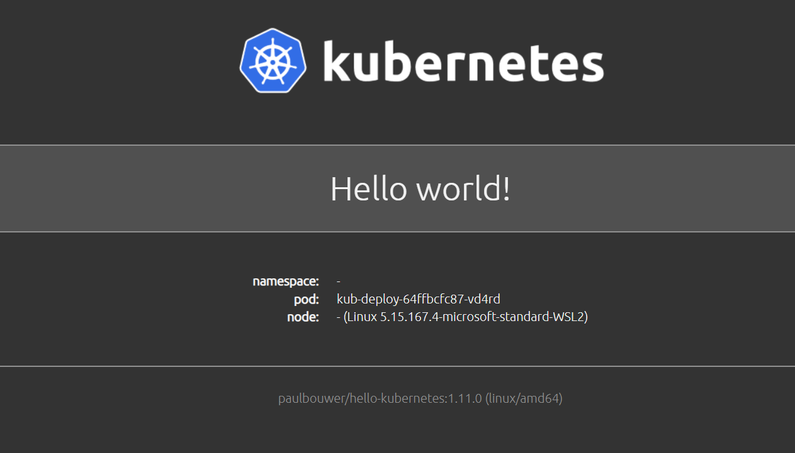

# Learning Docker and Kubernetes with hello-kubernetes

This project is my first hands-on practice with Docker and Kubernetes. I used the hello-kubernetes demo app, built its Docker image, and deployed it to a local Kubernetes cluster running in Docker Desktop.

## What I did

- Built a Docker image from the project's Dockerfile with `docker build`
- Wrote two Kubernetes manifests: `deployment.yaml` (Deployment) and `service.yaml` (Service)
- Deployed the application to a local cluster with `kubectl apply`
- Accessed the app locally with `kubectl port-forward`
- Scaled the Deployment to 3 replicas with `kubectl scale`
- Deleted a Pod and observed Kubernetes recreating it automatically

## Commands used

```bash
docker build -t hello-kubernetes .
kubectl config use-context docker-desktop
kubectl apply -f k8s
kubectl get pods
kubectl port-forward svc/kub-service 8080:80
kubectl scale deployment kub-deploy --replicas=3
```

## Result

The application runs on `http://localhost:8080`.


## What I learned

- A Deployment keeps a set number of Pods running and replaces the ones that fail.
- A Service gives Pods a stable address, and its `selector` must match the Pod labels.
- The `targetPort` of a Service must match the port the container listens on.